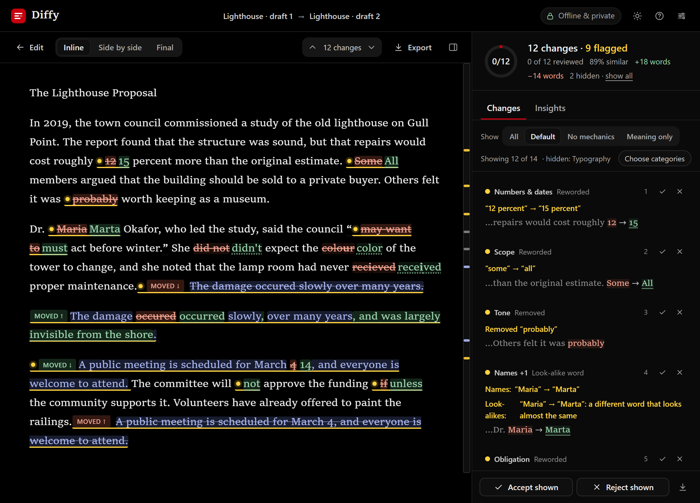

# Diffy

**See what changed between two drafts. Show them to no one.**



**[Open Diffy](https://krulsenpai.github.io/diffy/)** in your browser, or [download it](https://github.com/krulsenpai/diffy/releases/latest/download/diffy.html) to keep.

Paste two versions of a text. Diffy shows you every word that was added, removed, moved or quietly swapped, and points at the edits that change what the text says.

It is free. There is nothing to install and no account to make. And the text you paste never leaves your computer.

## Read the terms. Go on.

You have a contract and a "lightly revised" contract. You search *compare text online*, paste both into a stranger's text box, and get a tidy answer in two seconds.

Now open that site's terms of service.

Some of them take a **perpetual, irrevocable, worldwide licence** to use, reproduce and build on whatever you paste. No fee. No notice. No end date.

So that was your unsigned contract. Your unpublished chapter. Your medical letter. Your NDA, the one about not sharing things.

The tool was free because you paid with the text. Nobody reads the terms before pasting, and the whole business depends on that.

Diffy never receives your text in the first place. All the work happens on your own computer, inside your browser, and it keeps working with the internet switched off.

## What it does

- **Reads like an editor.** It compares sentence by sentence, so a paragraph that was split, merged or re-wrapped doesn't turn the whole page red. Changes are marked word by word, and a fixed typo letter by letter.
- **Flags what changes the meaning.** *will* → *will not*. *5 mg* → *50 mg*. *may* → *must*. *some* → *all*. A name, a date, a link that now points somewhere else.
- **Sees what you can't.** *liable* → *viable*. A letter from another alphabet hiding in a word. Invisible characters, and ones that flip the direction of the text.
- **Keeps the noise out of the way.** Spelling, punctuation, quotes, spacing and formatting each get a category you can hide. "Meaning only" leaves just the edits that matter.
- **Follows moves.** A paragraph that moved, even one edited on the way, shows up as a move, not as something deleted here and something new over there.
- **Track changes, minus Word.** Accept or reject each change, then copy or download the finished text.
- **Opens real files.** Word documents (`.docx`), plain text, Markdown and saved web pages.
- **Gives you something to send.** The finished text, a marked-up page that shows every change, a printout or a PDF.

## How to use it

1. **[Open Diffy](https://krulsenpai.github.io/diffy/)**.
2. Paste the old version into **Original** and the new one into **Revised**. Or drop two files onto the page: the older one becomes the original.
3. Press **Compare**.

Go through the changes one at a time and accept or reject each, the way you would with tracked changes in Word. A yellow dot marks a change that can alter the meaning. When you are done, open **Final** to copy or download the finished text.

Just curious? Press **Try an example** on the first screen.

If you like the keyboard: `J` `K` move between changes · `A` `R` accept or reject · `F` next flag · `G` other end of a move · `1` `2` `3` switch views · `?` everything else

## Is it really private?

Yes, and you can check without taking anyone's word for it.

- **Your text stays on your computer.** Diffy has nowhere to send it: there is no account, and nothing on the internet is waiting to receive what you paste.
- **It works offline.** Open Diffy, switch off your Wi-Fi, and compare something. It works exactly the same, because it never used the internet.
- **Nothing is kept.** Close the tab and your texts are gone. The only thing Diffy remembers is your settings, such as the theme, and those stay in your own browser.
- **Your browser enforces it.** The page carries a rule that forbids it from loading or sending anything, and it is your browser that applies the rule, not Diffy. The details are at the bottom of this page.

## Keep your own copy

[Download `diffy.html`](https://github.com/krulsenpai/diffy/releases/latest/download/diffy.html), save it anywhere, and double-click it. It opens in your browser like a web page, with or without internet. That one file is the whole program.

For anything sensitive, use your own copy. The online one is the same file, but a copy on your own disk is the one version nobody else can change.

Diffy cannot check for updates, because it cannot reach the internet. Press `?` inside Diffy to see which version you have, and look at the [releases](https://github.com/krulsenpai/diffy/releases) for a newer one.

## Good to know

- **PDFs and other formats.** Diffy opens Word `.docx` files, plain text, Markdown and saved web pages. For a PDF, an old `.doc` file or anything else, copy the text and paste it in.
- **Word files.** Diffy compares the words, not the look: fonts, bold and table layout are ignored. Tracked changes are read as if they had all been accepted.
- **Languages.** Diffy compares text in any language, and flags changed figures, links and look-alike characters in all of them. The flags for words like *not*, *must* and *all*, and the spelling checks, only know English.
- **A flag is a hint, not a verdict.** The yellow dots point at the edits most likely to matter, but an edit without a dot can still matter. For anything important, read every change. Out of the box Diffy tucks away pure spacing and quote-style changes; **All** brings them back.
- **Your browser.** Diffy needs a reasonably recent browser. If yours has not been updated in a couple of years, update it first.

---

## For the technically minded

Nothing below is needed to use Diffy.

### How the privacy is enforced

A privacy policy is a promise. Diffy ships a rule your browser enforces.

- **No requests.** The page's Content-Security-Policy says `default-src 'none'` and `connect-src 'none'`. The page cannot load, fetch or post anything: no uploads, analytics, fonts or CDNs.
- **One script.** `script-src` allows only the script inside the file, matched by its SHA-256 hash. Nothing injected or added can run beside it.
- **No way out.** A policy cannot stop a page from sending you to another address, so that part is the script's job: it has no links out and nothing that navigates. It is the only code that runs, and you can read it.
- **Nothing kept.** Your texts live in the tab and go when it closes. Only your settings are saved, in your browser's `localStorage`.
- **A copy you can verify.** The hash in the policy ties the script to the policy, and whoever edits the file can edit both. So each release also lists the SHA-256 of `diffy.html` itself. Match it and you have the released file, byte for byte.

Check it yourself: open DevTools, watch the Network tab, compare something. Or read the source. It is one file.

### Check your download

Every [release](https://github.com/krulsenpai/diffy/releases) lists the SHA-256 of `diffy.html`. Compare it with yours:

```bash
sha256sum diffy.html                    # Linux
shasum -a 256 diffy.html                # macOS
certutil -hashfile diffy.html SHA256    # Windows
```

### Why prose needed its own diff

Code never had this problem, because `git diff` runs on your own machine. Prose did. A line-based diff turns one moved comma into a red paragraph, so people went online instead. Diffy lines up sentences instead of lines, then compares the words inside them.

### More about files and exports

- Plain text is read in most encodings. From `.docx` files, footnotes and endnotes come along too.
- Markdown and HTML markup is understood: a formatting change gets its own category, and a link that now points elsewhere is flagged.
- CriticMarkup export: your decisions are applied and the changes you left open become suggestions.

### Host your own

It is a static file. Fork the repo, turn on GitHub Pages, done.

### Change it

Edit the script in `diffy.html`, then:

```bash
node rehash.mjs        # re-pin the script's hash, or the browser won't run your edit
node --test tests/     # a few seconds, no dependencies
```

The tests check, among other things, that accepting or rejecting every change gives back your exact text.

## License

[AGPL-3.0](LICENSE). Copyright (C) 2026 krulsenpai.

Use it, fork it, host it. If you host a modified Diffy for other people, you share your source with them. If that sounds strict, scroll back up.
